<a href="https://cyenite.github.io/activity/">
  <picture>
    <source media="(prefers-color-scheme: dark)" srcset="assets/activity-dark.svg">
    
  </picture>
</a>

<!-- repos:start -->

<a href="https://cyenite.github.io/activity/"><b>Open the interactive chart</b></a>

NEW PUBLIC REPOS <a href="https://github.com/cyenite/xBO">xBO</a> · <a href="https://github.com/cyenite/shorecat">shorecat</a> · <a href="https://github.com/cyenite/OpenTerm5">OpenTerm5</a> · <a href="https://github.com/cyenite/os">os</a> · <a href="https://github.com/cyenite/noryxon">noryxon</a>

<!-- repos:end -->
